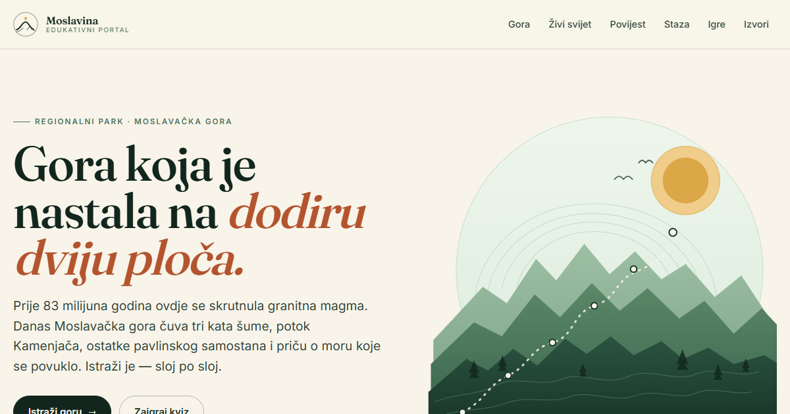

# Moslavina — edukativni portal Moslavačke gore

Statični edukativni portal o Moslavačkoj gori: geologiji, biljkama i životinjama, pavlinskom samostanu Bela crkva i poučnoj stazi **Crkveni jarak**. Uz sadržaj dolaze četiri kviza i križaljka, a struktura je pripremljena za dodavanje novih igara.

**Živa verzija:** https://borna12.github.io/moslavina/



## Što sadrži

| Stranica | Sadržaj |
| --- | --- |
| `index.html` | Početna: uvod, ključne brojke, četiri tematske cjeline, igre |
| `gora.html` | Geologija: Savska zona, granitni pluton, presjek gore, stijene i minerali, geolokaliteti, nafta, klizišta i potresi |
| `zivi-svijet.html` | Šuma u tri kata, 242 biljne i 155 životinjskih vrsta, zaštićene vrste |
| `povijest.html` | Pavlinski samostan Blažene Djevice Marije (Bela crkva), utvrde, Gradina Mariš, vremenska crta |
| `staza.html` | Interaktivna shema staze Crkveni jarak, 12 stajališta, ulazi, pravila i praktične informacije |
| `igre.html` | Središte igara i praćenje napretka |
| `igre/kviz.html` | Kvizovi: stijene, biljke, životinje i zanimljivosti (da/ne) |
| `krizaljka.html` | Križaljka sa 16 pojmova iz geologije, šume i povijesti |
| `izvori.html` | Popis izvora i literatura |

Igre imaju 12 pitanja po kvizu, objašnjenje nakon svakog odgovora, završnu značku i lokalno pamćenje najboljeg rezultata. Križaljka ima provjeru, otkrivanje slova i rješenja te tipkovničku navigaciju.

## Kako pokrenuti lokalno

Portal ne treba bazu ni build korak.

1. **Najbrže:** dvaput klikni `index.html`.
2. **Preporučeno (lokalni poslužitelj):** u mapi projekta pokreni

   ```bash
   python -m http.server 8000
   ```

   pa otvori `http://localhost:8000/`.

Poslužitelj je preporučen jer preglednici na `file://` ponekad blokiraju učitavanje fontova. Svi ostali sadržaji (slike, skripte, igre) rade i bez poslužitelja.

## Struktura

```text
assets/
  css/style.css        — cijeli vizualni sustav
  css/fonts.css        — lokalni fontovi (Fraunces, Inter)
  fonts/               — woff2 datoteke
  js/site.js           — navigacija, podnožje, animacije, napredak
  js/quiz.js           — engine kviza
  js/crossword.js      — engine križaljke
  js/trail.js          — interaktivna karta staze
  js/data/kvizovi.js   — pitanja i objašnjenja
  js/data/krizaljka.js — mreža i pojmovi križaljke
  img/                 — ilustracije iz infopanela, SVG grafike, OG naslovnica
izvori/                — znanstveni radovi s Hrčka i tekstovi enciklopedije
_skripte/              — pomoćni alati za izradu sadržaja (nisu dio stranice)
.github/workflows/     — automatska objava na GitHub Pages
```

## Dodavanje novog kviza

1. U `assets/js/data/kvizovi.js` dodaj novi ključ po uzoru na postojeće:

   ```js
   mojKviz: {
     naslov: "Naslov kviza",
     kratko: "Kratki opis",
     opis: "Uvodni tekst na početnom ekranu.",
     ikona: "spark",
     boja: "#3f6b52",
     mode: "choice",           // ili "truefalse"
     pitanja: [
       { q: "Pitanje?", o: ["A", "B", "C", "D"], a: 2, e: "Objašnjenje." }
     ]
   }
   ```

   `a` je indeks točnog odgovora (0–3 za `choice`, 0 = Da / 1 = Ne za `truefalse`).

2. Kviz je odmah dostupan na `igre/kviz.html?k=mojKviz`.
3. Dodaj karticu na `igre.html` i, po želji, na `index.html` te poveznicu u podnožju (`assets/js/site.js`).

Bodovi se spremaju u `localStorage` pod ključem `moslavina.progress.v1`, zasebno za svaki kviz. Podaci ostaju u pregledniku.

## Dodavanje nove igre

Igre su obične stranice s vlastitim JS-om. Novu igru dodaj kao `moja-igra.html` (ili mapu u `igre/`), uključi `assets/js/site.js` radi navigacije i podnožja, a karticu dodaj na `igre.html`. Ako igra ima rezultat, koristi `window.Moslavina.recordScore("moja-igra", bodovi, ukupno)`.

Križaljka se generira skriptom `_skripte/crossword.py` iz popisa pojmova; rezultat se zapisuje u `assets/js/data/krizaljka.js`. Skripta provjerava da se svi pojmovi sijeku bez nehotičnih susjednih riječi.

## Objava na GitHub Pages

Repozitorij je pripremljen za automatsku objavu: `.github/workflows/pages.yml` na svaki push na `main` objavljuje stranicu na GitHub Pages.

1. U repozitoriju otvori **Settings → Pages**.
2. Pod **Build and deployment → Source** odaberi **GitHub Actions** (ako već nije odabrano).
3. Pushaj na `main` ili ručno pokreni workflow **Deploy static site to Pages** u kartici **Actions**.

Stranica će biti dostupna na `https://borna12.github.io/moslavina/`.

## Izvori i prava korištenja

- Polazišni tekst: Nataša Mravunac, „Moslavina — iz geološke perspektive“, *Zbornik Moslavine XIX*.
- Terenski materijali: infopaneli, karte i natpisi poučne staze Crkveni jarak (Grad Kutina, Turistička zajednica Grada Kutine).
- Znanstveni radovi: Hrčak (poveznice u `izvori.html` i `izvori/README.md`).
- Enciklopedijske natuknice: Hrvatska enciklopedija, Leksikografski zavod Miroslav Krleža.

Ilustracije biljaka, životinja i stijena izrađene su iz infopanela staze u edukativne svrhe. **Prije daljnje javne objave i komercijalne upotrebe potrebno je provjeriti uvjete korištenja s izdavačem** (Grad Kutina / TZZ Grada Kutine). Za znanstvene tvrdnje navedeni su izvori; kod preuzimanja u nove materijale zadrži atribuciju.

## Napomena o sadržaju

Brojke o bioraznolikosti (242 biljne vrste, 55 zaštićenih, 155 životinjskih vrsta, 84 zaštićene, 64 vrste ptica) preuzete su iz infopanela i rada Vrsaljka i suradnika. Geološki podaci uglavnom su iz rada Nataše Mravunac. Starije enciklopedije navode da je granit paleozojski, dok novija datiranja govore o oko 83 milijuna godina — u portalu je to objašnjeno kao primjer kako se znanje mijenja.

## Tehnologije

Čisti HTML, CSS i JavaScript. Nema okvira, ovisnosti ni build alata. Fontovi su lokalni (Fraunces i Inter). Radi u suvremenim preglednicima, na računalu i na mobitelu.
